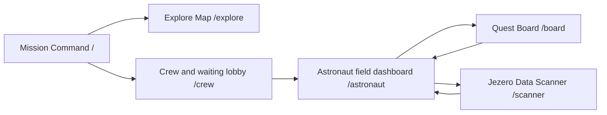

# Astronaut Guild site map

| Screen | Primary question | Main action |
| --- | --- | --- |
| Mission Command | Where could we go? | Browse the location carousel |
| Explore Map | What is available at each region? | Orbit the global image or elevation map and select a destination |
| Crew and waiting lobby | Who is going, where, and are they ready? | Create a character, join up to four members, choose a base, launch |
| Astronaut field dashboard | What is happening on this excursion? | Inspect the local 3D map, crew, quests, zones, resources, and scenarios |
| Quest Board | What science should the crew conduct? | Place a local map pin, post and manage a scientific task |
| Jezero Data Scanner | What does the bundled observation data show? | Compare optical, elevation, thermal, and analysis views |

The public header contains only Mission Command, Explore Map, and Quest Board. Crew preparation is entered from Mission Command. Astronaut field operations require a launched crew, and a single astronaut may launch alone. Explore uses map markers for region selection and opens details in a temporary map overlay.

Jezero is the only destination with bundled local NASA observations. Gale Crater and Melas Chasma are explicitly simulated field previews. The Explore globe displays archival global Viking imagery or MOLA elevation for orientation; the Astronaut Map is a local mission dashboard. Quest Board pins use the 2,048 m local sector coordinate system for the room's selected destination.
